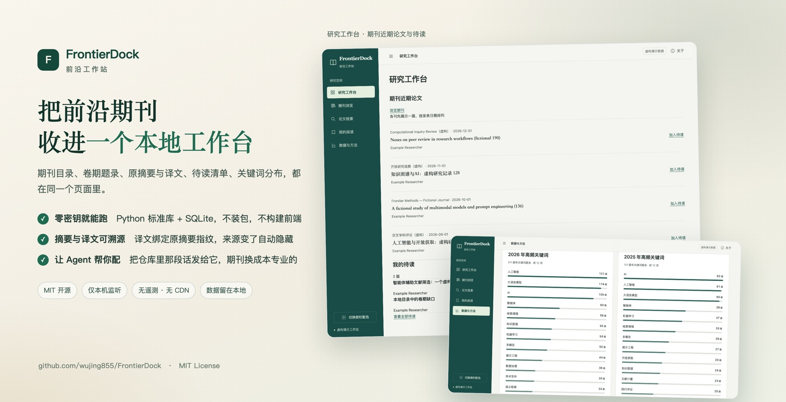
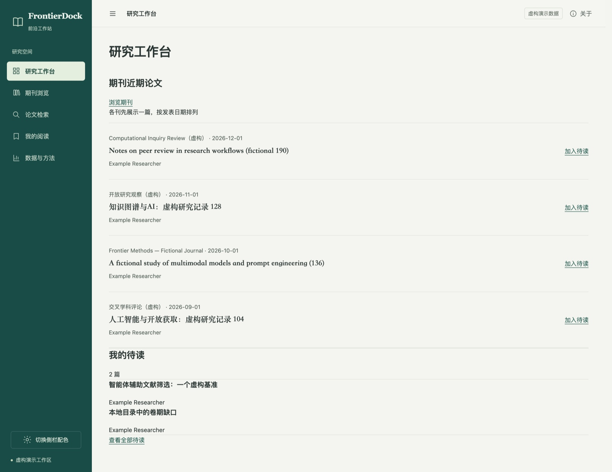
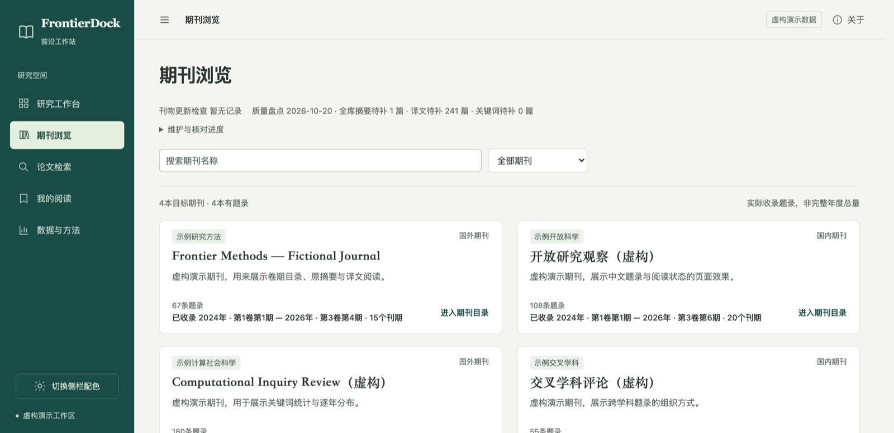
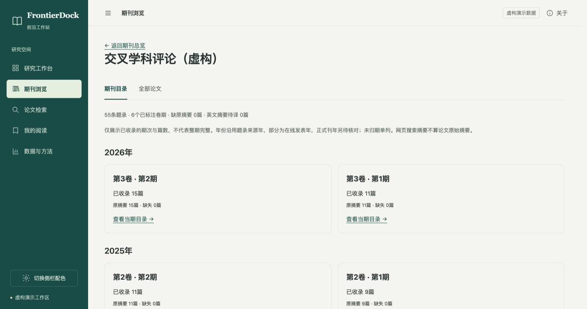
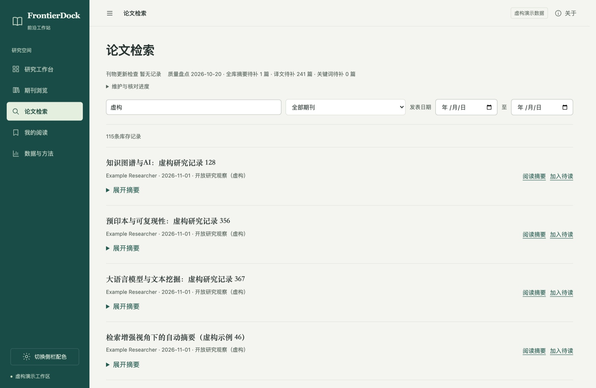
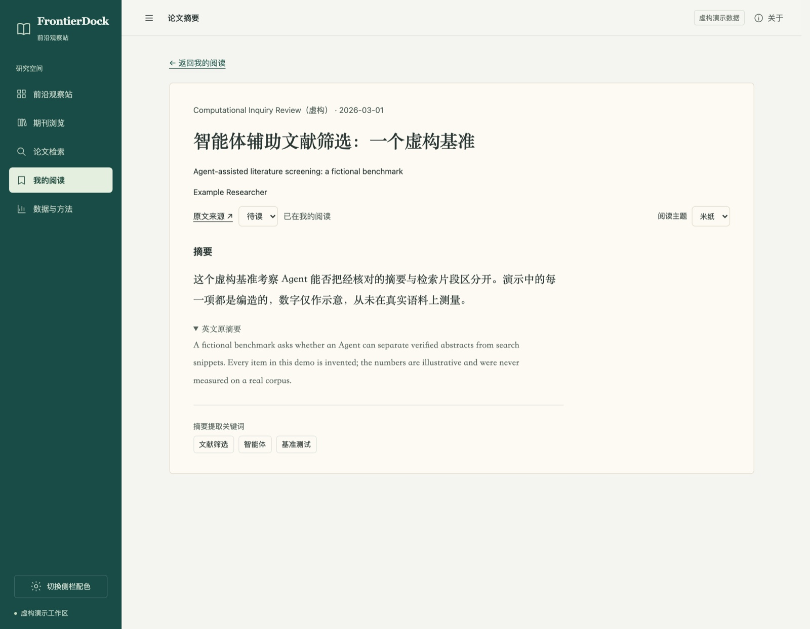
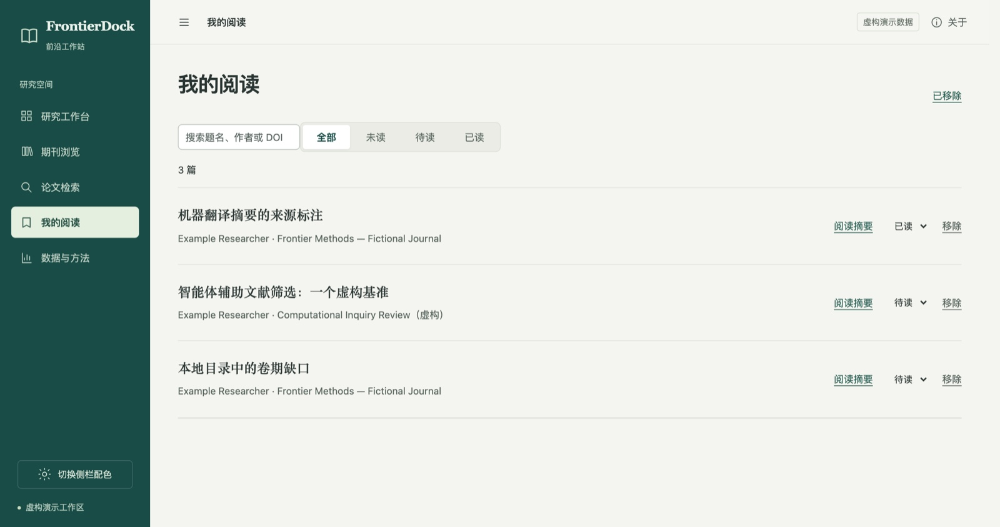
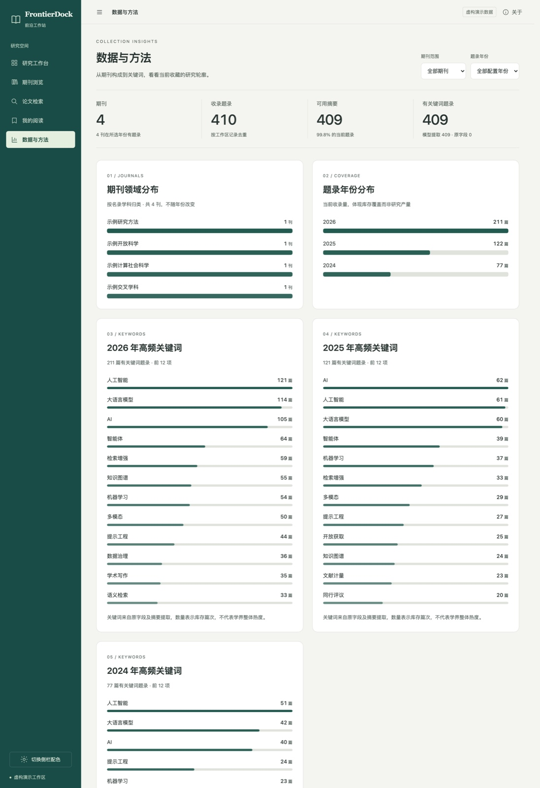

<div align="center">



# FrontierDock

**Build your own research frontier.**

An open-source, self-hosted research intelligence platform.

[中文](README.md) · **English**


[](https://github.com/wujing855/FrontierDock/releases)

Journal directories, issue lists, original abstracts and translations, a reading queue and keyword insights in one local workspace.

**No API key required · Python standard library + SQLite · No front-end build · Your data stays on your machine**

</div>

---

## Install with your Agent

Send this to the Agent you already use. Any Agent that can read local files and run commands will do.

```text
Set up a local research workbench for me: https://github.com/wujing855/FrontierDock

Read skills/frontierdock-setup/SKILL.md first and follow its flow: ask me about my field and how I read,
offer options I can skip and change later, then verify everything works before handing it over.
If something breaks, diagnose and fix it locally first instead of sending me to file a report.
```

The Agent asks about your field, whether to use Crossref or its own search, whether to translate abstracts, whether to connect MinerU, and when to check for updates. Every choice can be skipped and changed later. No journal list, discipline or interface is fixed by the project.

## Quick start

Python 3.11 or newer. The base application needs no third-party package.

```sh
python3 -m frontierdock init --workspace workspace --demo
python3 -m frontierdock serve --workspace workspace
```

Open **http://127.0.0.1:8876** . The four demo journals and the 400+ records in them are fictional and must not be cited. For real research, create a separate empty workspace:

```sh
python3 -m frontierdock init --workspace my-research
```

## Screens

Captured from the `--demo` workspace; journals, papers and keywords are all fictional.



**Workbench**: one recent paper per journal, plus your reading queue.



**Journals**: each card states how many issues this workspace actually holds, and which year and issue it reaches.



**Issue directory**: issues grouped by year. Missing issues stay missing.



**Search**: filter by title, DOI, author, journal and date; change reading state in place.



**Reader**: translation on top, the original abstract one click away, extracted keywords below. Rice-paper, plain and night reading themes.



**Reading list**: unread, to-read and completed, with removal and restore.



**Insights**: field split, yearly coverage and per-year keywords, each card stating what it actually counts.

## What runs where

```sh
python3 -m frontierdock plan     --workspace my-research   # which journals are due
python3 -m frontierdock update   --workspace my-research   # bounded retrieval
python3 -m frontierdock maintain --workspace my-research   # translations and keywords
python3 -m frontierdock doctor   --workspace my-research   # local self-check
```

`update` in its default mode only writes a task queue (`requests/agent_tasks.json`); an actual Agent has to execute it. A Python process cannot silently borrow the host Agent's web tools, and unattended API mode needs credentials plus an external scheduler you choose.

## Research integrity

- Search snippets and summaries are discovery clues, never the authors' original abstract
- Crossref abstracts are labelled as deposited metadata; a partial retrieval window is stated as partial
- Translations and extracted keywords carry a fingerprint of the source title and abstract; stale derived text is hidden
- A DOI that reappears with a different title or journal keeps the existing record and enters a review queue
- Unknown volumes and issues stay unknown
- Every run has a request budget

## Credentials and optional services

Nothing needs configuring by default. To enable an adapter:

```sh
python3 -m frontierdock key set llm       # OpenAI-compatible translation and keyword API
python3 -m frontierdock key set deepseek  # DeepSeek Search / Fetch
python3 -m frontierdock key set mineru    # MinerU PDF extraction
```

Keys are stored in `frontierdock/secrets/` under your user config directory, outside the project and outside the workspace, or supplied through environment variables. A successful save only means the local file was written; live access and free quota need separate verification.

## Community

There is a Chinese-speaking community around this project, **AI Open Space**, for undergraduates, graduate students and AI enthusiasts: models and agents, hands-on AI tools, literature reading, academic writing and interdisciplinary work. Members set their nickname to `field|name`.

The group QR code expires on 27 October 2026; after that, add the maintainer.


## Data and licensing

MIT licensed; KaTeX retains its own [MIT notice](web/vendor/katex/LICENSE). Papers, abstracts and PDFs you import keep their original rights, and software licensing does not make them publishable.

Workspaces, keys, logs and reading history stay local. Before publishing a change:

```sh
python3 -m unittest discover -s tests -v
node --test tests/ui.test.mjs
python3 scripts/release.py --check
```

See the [data contract](docs/DATA_CONTRACT.md), [privacy](docs/PRIVACY.md), [integration status](docs/INTEGRATIONS.md), [troubleshooting](docs/TROUBLESHOOTING.zh-CN.md) and [contributing](CONTRIBUTING.md).
