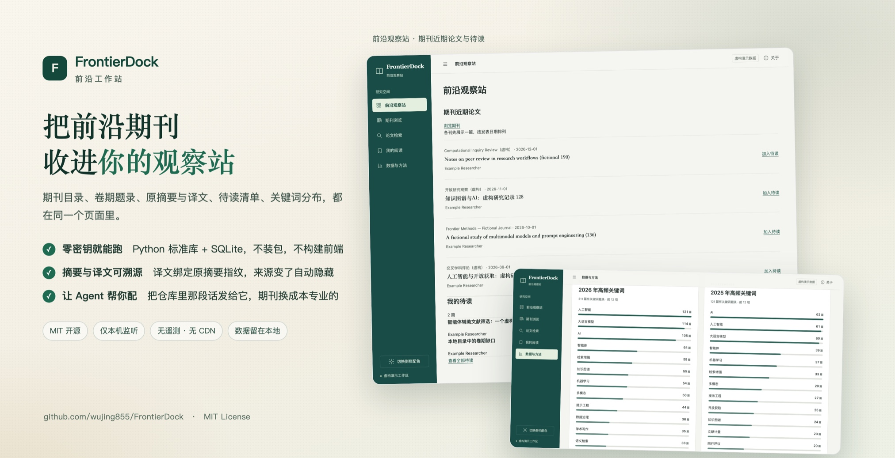
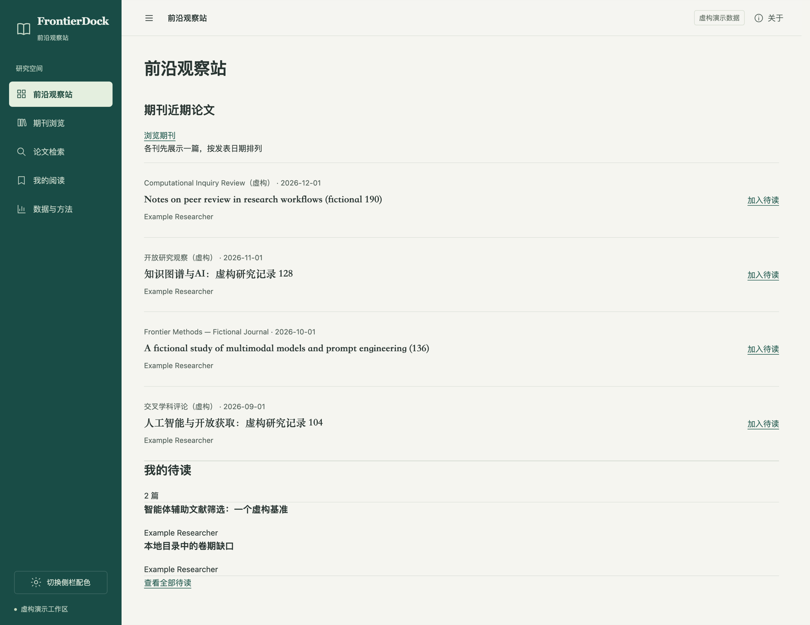
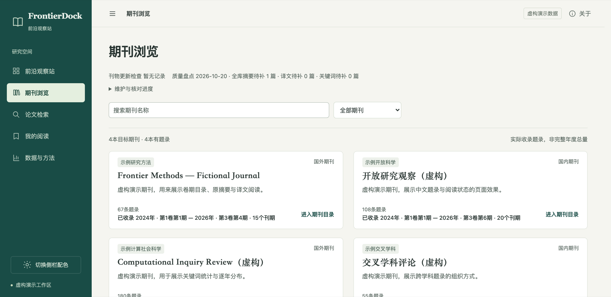
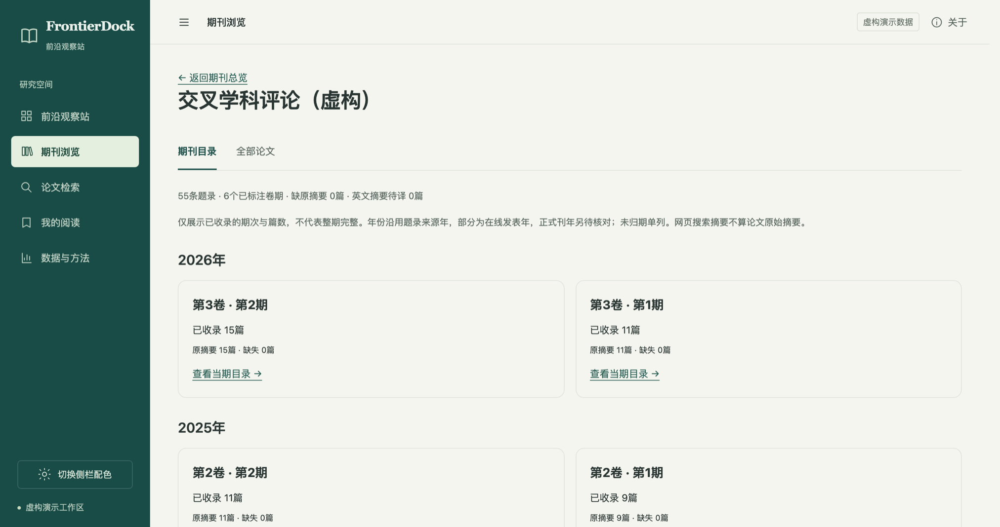
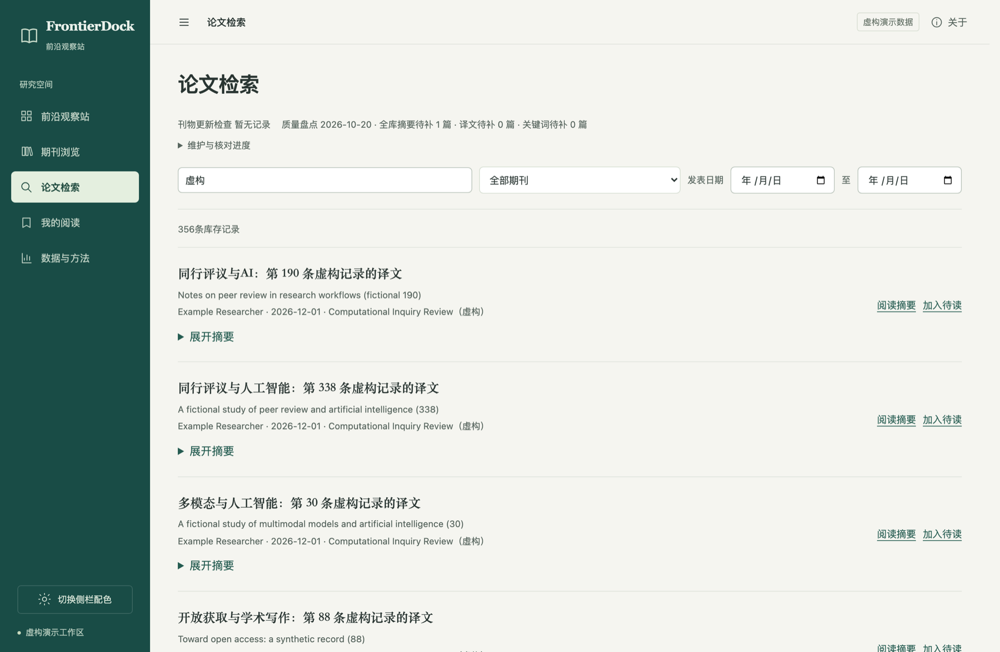
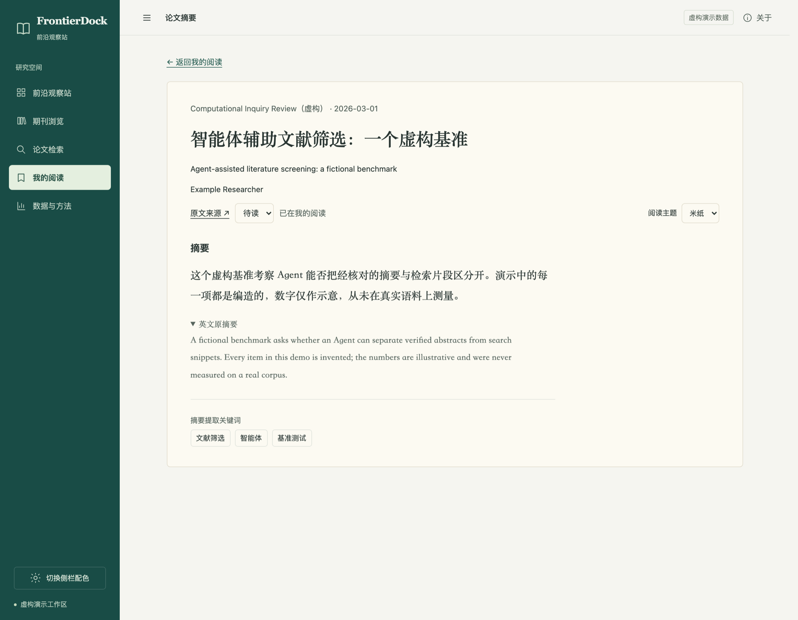
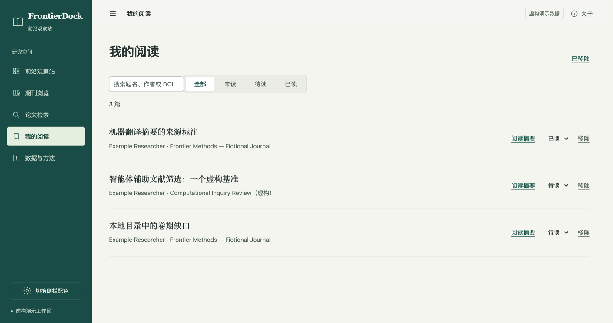
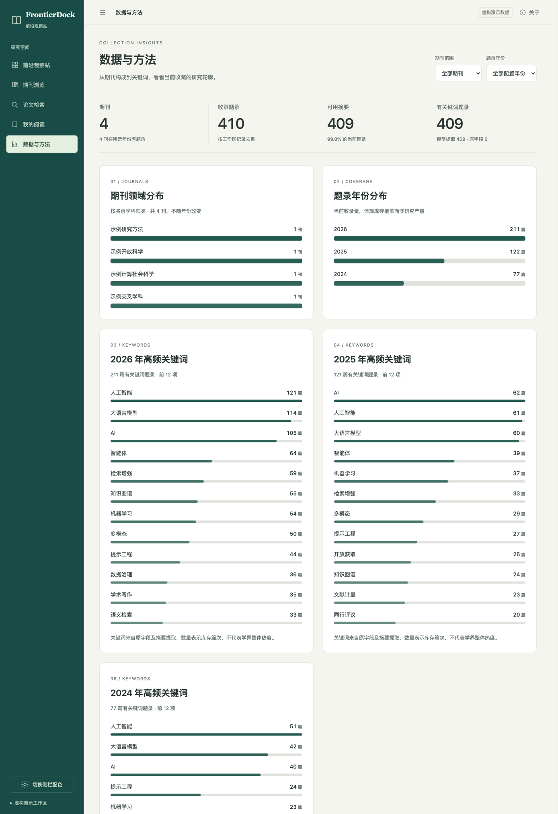

<div align="center">



# FrontierDock · 前沿观察站

**Build your own research frontier.**

An open-source, self-hosted research intelligence platform.

**中文** · [English](README.en.md)


[](https://github.com/wujing855/FrontierDock/releases)

期刊目录、卷期题录、原摘要与译文、待读清单、关键词分布，都在同一个本地页面里。

**不用 API 密钥也能跑 · Python 标准库 + SQLite · 没有前端构建 · 数据不出本机**

[快速开始](#快速开始) · [它长什么样](#它长什么样) · [能做什么](#能做什么) · [研究完整性](#研究完整性) · [交流](#交流)

</div>

---

## 让 Agent 帮你装

把下面这段直接发给你常用的 Agent。能读写本地文件的都会做，不挑平台。

```text
帮我装一个前沿观察站（FrontierDock）：https://github.com/wujing855/FrontierDock

请先读仓库里的 skills/frontierdock-setup/SKILL.md，按它的流程陪我配置：
先问我关注什么领域、平时怎么读文献，给出一批可以跳过、以后能改的选项，装完逐项验证再交给我。
遇到小问题你先诊断修复，别让我一开始就去提交反馈。
```

> 上面是普通代码块，右上角有复制按钮。只提供网页问答的 Agent 没法操作你的电脑，需要你照着它给的步骤执行。

Agent 会问你几件事：关注什么领域、要用 Crossref 还是它自己搜、摘要要不要翻成中文、PDF 要不要接 MinerU、什么时候检查更新。每一项都能跳过，之后随时改。领域、期刊表、界面都按你的来，不会把别人的期刊清单塞给你。

## 快速开始

需要 Python 3.11 或更新版本。基础功能不需要安装任何第三方包。

```sh
python3 -m frontierdock init --workspace workspace --demo
python3 -m frontierdock serve --workspace workspace
```

浏览器打开 **http://127.0.0.1:8876** 。演示里的四本期刊和四百多条题录全是虚构的，只能看效果，不能引用。要装自己的资料，另建一个空白工作区即可。

```sh
python3 -m frontierdock init --workspace my-research
```

## 它长什么样

截图取自 `--demo` 工作区，期刊、论文、关键词全部虚构。



**前沿观察站**：每本刊先露一篇，右侧是待读清单，点标题直接进摘要页。



**期刊浏览**：每张卡片写明本工作区实际收录了几卷几期、覆盖到哪一年哪一期。空档不假装完整。



**卷期目录**：按年份列出已收录的期号，缺哪期就少哪一期，不为了填齐而编造。



**论文检索**：题名、DOI、作者、期刊、日期都能筛，行内直接切换阅读状态。



**摘要阅读**：中文译文在上，点开就是英文原摘要，下面是提取的关键词。米纸、清白、夜读三种阅读主题。



**我的阅读**：未读 / 待读 / 已读三态，移除之后还能还原，历史状态单独保留。



**数据与方法**：领域分布、年份覆盖、逐年高频关键词，统计口径写在卡片下方，不冒充学界热度。

## 能做什么

| 页面 | 内容 |
|---|---|
| 前沿观察站 | 各刊近期论文一屏聚合，直接加入待读 |
| 期刊浏览 | 期刊卡片、卷期目录、当期题录，收录缺口如实显示 |
| 论文检索 | 题名、DOI、作者、期刊与日期筛选 |
| 摘要阅读 | 原摘要、译文、来源链接、提取关键词、阅读主题 |
| 我的阅读 | 未读 / 待读 / 已读，移除与还原 |
| 数据与方法 | 领域分布、年份覆盖、逐年关键词 |

后台还有几条命令，都在本机跑：

```sh
python3 -m frontierdock plan     --workspace my-research   # 哪些刊到期了
python3 -m frontierdock update   --workspace my-research   # 按间隔抓取，每轮有上限
python3 -m frontierdock maintain --workspace my-research   # 补译文与关键词
python3 -m frontierdock doctor   --workspace my-research   # 自检
```

`update` 的默认模式只写任务队列（`requests/agent_tasks.json`），需要你的 Agent 真正去执行。Python 进程没办法偷偷调用宿主 Agent 的搜索工具，这是设计上的取舍。

## 研究完整性

这类工具最容易出的问题，是把检索摘要当成作者原摘要。这里做了几件事：

- 搜索返回的片段只当线索，永远不写进原摘要字段
- Crossref 拿到的摘要标注为寄存元数据，检索窗口不完整会明说
- 译文和提取关键词绑定原摘要指纹，来源一改，旧译文自动隐藏
- 同一个 DOI 出现不同题名或期刊，保留原记录并进入复核队列，不静默覆盖
- 卷期未知就留未知，不靠推算补齐
- 每轮抓取有数量上限，失败重试有边界

## 密钥与外部服务

默认一个都不用配。要接的话：

```sh
python3 -m frontierdock key set llm       # 兼容 OpenAI 的翻译与关键词接口
python3 -m frontierdock key set deepseek  # DeepSeek Search / Fetch
python3 -m frontierdock key set mineru    # MinerU PDF 提取
```

密钥存在用户配置目录的 `frontierdock/secrets/`，不在项目里，也不在工作区里，也可以改用环境变量。保存成功只代表本地写入了文件，联网调用和免费额度要另行验证。

外部服务都是可选项：Crossref 按核实过的 ISSN 取一段最新记录；DeepSeek 只给网页线索；MinerU 云端必须对选中的文件明确允许上传；定时运行需要你自己选一个调度器。项目不会自动安装开机启动项。

## 交流

用着卡住，先让你的 Agent 跑一遍 `doctor` 和 `plan`，多数问题能当场解决。想聊改造思路、AI 工具和科研用法，欢迎来群里。

**AI Open Space** 是面向本科生、研究生和 AI 爱好者的开放社群，关注大模型与智能体、ChatGPT / Claude / Gemini 这类工具的实际用法、文献阅读与学术写作，也聊跨学科的想法。进群后把昵称改成「专业+昵称」，例如 `生物医学|小明`，方便找到同行。群里不发广告，引用别人的资料时照旧守学术规范。

群二维码有效期到 2026 年 10 月 27 日。过期就扫下面的个人微信，我拉你进群。


## 开源与数据

MIT 许可证，KaTeX 保留自己的 [MIT 声明](web/vendor/katex/LICENSE)。你自己导入的论文、摘要和 PDF 仍受原有权利约束，不会因为软件开源就一起公开。

工作区、密钥、日志、阅读记录都留在本地。发布前请跑一遍项目自带的检查与打包程序：

```sh
python3 -m unittest discover -s tests -v
node --test tests/ui.test.mjs
python3 scripts/release.py --check
```

更多细节见[数据契约](docs/DATA_CONTRACT.md)、[隐私说明](docs/PRIVACY.md)、[接入状态](docs/INTEGRATIONS.md)、[排错](docs/TROUBLESHOOTING.zh-CN.md)和[贡献指南](CONTRIBUTING.md)。
