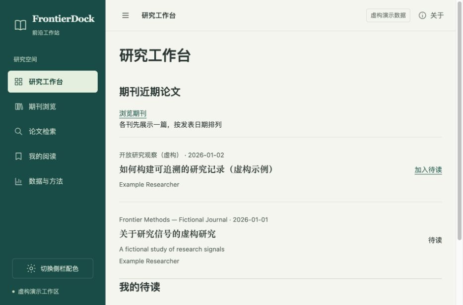

# FrontierDock · 前沿工作站

**Build your own research frontier.**

An open-source, self-hosted research intelligence platform.

[中文使用说明](README.zh-CN.md) · [Agent setup skill](skills/frontierdock-setup/SKILL.md) · [Product introduction](docs/INTRODUCTION.zh-CN.md)

FrontierDock keeps journal discovery, issue directories, paper search, original abstracts, translations, a reading queue and collection insights in one local workspace. Your Agent helps choose journals and adapt the workflow to your field. You can change the interface and integrations as well as the configuration.

The default setup needs **no API key**. It runs on Python 3.11+ using the standard library, with a browser UI and SQLite. KaTeX is bundled for local mathematical rendering; no CDN or build step is required.



## Try it locally

From the extracted repository directory:

```sh
python3 -m frontierdock init --workspace workspace --demo
python3 -m frontierdock serve --workspace workspace
```

Open **http://127.0.0.1:8876**. The two demo journals and their papers are explicitly fictional. For real research, initialize a different empty workspace without `--demo`.

## Make it yours

Give your Agent this prompt:

> Read `skills/frontierdock-setup/SKILL.md` in this repository. Help me configure FrontierDock for my own research. Ask about my preferences in small groups, offer choices I can skip, and help me run and verify the result. Keep credentials and my research data private.

Choose Agent-assisted search, structured Crossref retrieval, or optional DeepSeek Search/Fetch. Translate abstracts with your Agent or an OpenAI-compatible API. MinerU cloud/local extraction is optional. No particular discipline, fixed journal list, model provider or machine path is required.

## What runs automatically

```sh
python3 -m frontierdock plan --workspace workspace
python3 -m frontierdock update --workspace workspace
python3 -m frontierdock maintain --workspace workspace
python3 -m frontierdock doctor --workspace workspace
```

`plan` checks which journals are due. `update` respects due dates and per-run limits. Agent mode writes a task queue; an actual Agent must execute it. A Python process cannot silently borrow the host Agent's web tools. Unattended API mode requires working provider credentials and an external scheduler configured by the user. No scheduler or system service is installed by this project.

## Research integrity

Search snippets and summaries are **web discovery clues**, never the authors' original Abstract. Crossref abstracts are labelled as deposited metadata. Conflicting identities keep the existing record and enter a review queue. Translation and extracted keywords carry a fingerprint of the source title and abstract. Partial retrieval never implies a complete issue or year.

## Development

```sh
python3 -m unittest discover -s tests -v
node --test tests/ui.test.mjs
python3 scripts/release.py --check
```

See [architecture and contracts](docs/DATA_CONTRACT.md), [privacy](docs/PRIVACY.md), [troubleshooting](docs/TROUBLESHOOTING.zh-CN.md), [integration status](docs/INTEGRATIONS.md) and [contributing](CONTRIBUTING.md). Optional provider adapters need live validation with your own account; passing local tests does not verify provider access or free quota.

MIT licensed. Third-party KaTeX retains its own [MIT notice](web/vendor/katex/LICENSE). Research materials imported by users retain their original rights.

## Community

If something breaks, ask your own Agent to run `doctor` and `plan` first; most problems are local and fixable. For discussion about adapting the workbench, AI tools and research workflows, there is a Chinese-speaking community around this project.

**AI Open Space** is an open study group for undergraduates, graduate students and AI enthusiasts: large models and agents, hands-on use of ChatGPT, Claude, Gemini and similar tools, literature reading, academic writing and interdisciplinary exploration. Members set their nickname to `field|name` so others can find them. No advertising, and normal academic citation rules still apply.

The group QR code expires on 27 October 2026. After that, add the maintainer.


